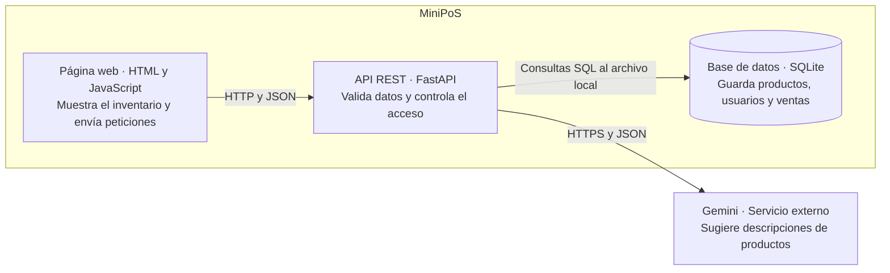

# Arquitectura de MiniPoS

## Diagrama C4 de contenedores

La página se sirve en el puerto `5500` y se comunica con la API en el puerto `8000`. FastAPI consulta el archivo local `productos.db`. Para las pruebas, `EXTERNO_URL` permite usar el simulador en el puerto `9000` en lugar de llamar a Gemini.